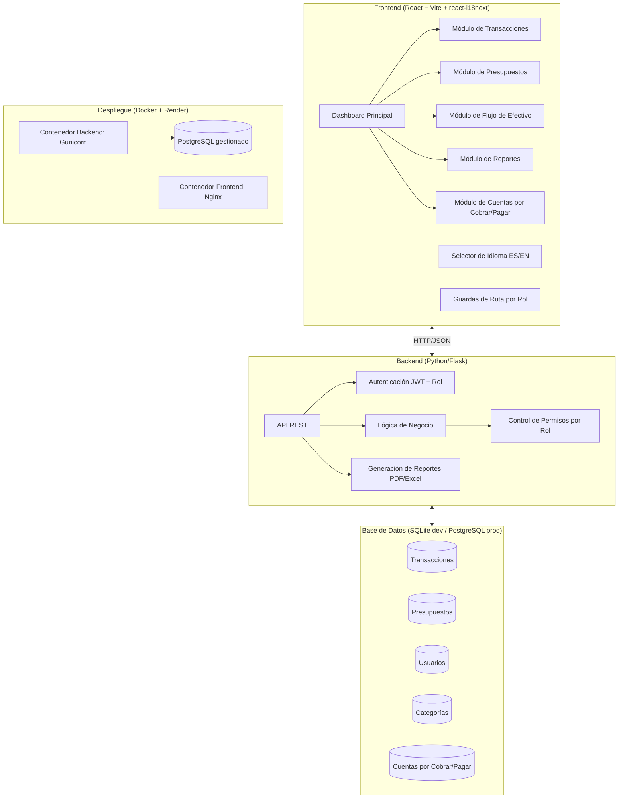
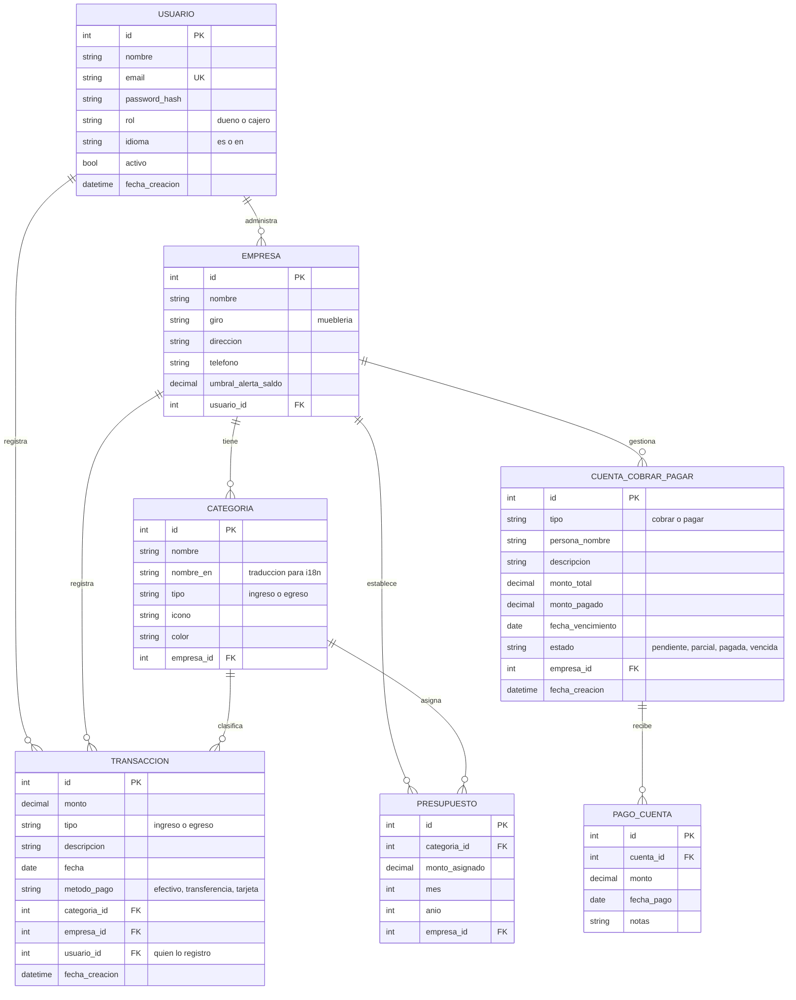
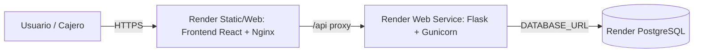

# Sistema de Control de Flujo de Efectivo y Presupuestos para PyMEs

## Contexto del Proyecto

**Residencia Profesional** — TecNM Campus Chicontepec
**Modalidad:** Proyecto individual
**Duración:** 3 meses (3 fases)

**Problema:** Las micro y pequeñas empresas (PyMEs) no llevan un control adecuado de su dinero: no saben cuánto entra, cuánto sale, ni cuánto van a necesitar. Esto causa problemas de liquidez y decisiones financieras desinformadas.

**Objetivo:** Desarrollar un sistema web que permita a una PyME llevar el control de su flujo de efectivo y presupuestos, para planear mejor su dinero y tomar decisiones más informadas.

**Negocio de aplicación (caso de estudio):** **Mueblería** de fabricación y venta de muebles a medida y de línea. Este giro tiene características que el sistema debe resolver bien:

- **Cobro por anticipos y abonos:** el cliente aparta un pedido con anticipo y paga el resto a la entrega → genera cuentas por cobrar reales.
- **Materia prima variable:** madera, tableros (MDF/triplay), telas, espumas y herrajes se compran por lote, no todos los días.
- **Pago a destajo:** carpinteros y tapiceros cobran por pieza terminada, no siempre por nómina fija.
- **Ciclo de producción largo:** entre comprar la materia prima y cobrar el mueble pasan semanas → el flujo proyectado es crítico para no quedarse sin efectivo.

---

## Decisiones Confirmadas

> [!IMPORTANT]
> Estas decisiones ya fueron validadas con la residente y **no están abiertas a discusión**; el plan se construye sobre ellas.

| # | Tema | Decisión |
|---|---|---|
| 1 | **Giro del negocio** | Mueblería (fabricación y venta de muebles). Categorías de ingresos/egresos personalizadas para este giro. |
| 2 | **Modalidad** | Proyecto **individual** (una sola persona desarrollando). |
| 3 | **Duración** | **3 meses**, organizados en 3 fases (una por mes). |
| 4 | **Roles de usuario** | **Dos roles: dueño (acceso completo) y cajero (registro de transacciones del día y resumen básico).** Permisos definidos por rol. |
| 5 | **Idioma de la interfaz** | **Bilingüe español/inglés con selector de idioma** en la interfaz (react-i18next). |
| 6 | **Despliegue** | **En internet con Docker + Render** (mismo esquema que el proyecto anterior). |

### Stack Tecnológico Confirmado

> [!IMPORTANT]
> **Stack:** React + Vite (frontend) con Python/Flask (backend), SQLite en desarrollo y PostgreSQL en producción.
> - React es ampliamente usado y documentado, ideal para dashboards interactivos
> - Flask es ligero, fácil de aprender, y Python ya está instalado en el sistema
> - SQLite no requiere instalar servidores de BD adicionales (el archivo `.db` vive en el proyecto)
> - En la defensa se puede mostrar que el sistema migra a PostgreSQL **solo cambiando la variable `DATABASE_URL`**, sin tocar el código

### Estado del Entorno (verificado)

> [!NOTE]
> Ya verifiqué la máquina donde se desarrollará. Esto reemplaza los avisos del plan anterior:

| Requisito | Estado |
|---|---|
| **Git** | ✅ Instalado (2.55.0). Repositorio ya inicializado en rama `master`, **sin commits todavía**. |
| **Política de ejecución de PowerShell** | ✅ Ya está en `RemoteSigned` (`CurrentUser`). No requiere cambios. |
| **Node.js / npm** | ✅ Node 26.5.0 y npm 11.17.0 instalados. |
| **Python** | ✅ 3.13.9 disponible con el lanzador `py -3.13` (también hay 3.11.4 como `python`). |
| **Docker Desktop** | ❌ **Pendiente de instalar** (requisito de la decisión de despliegue). |
| **Cuenta en Render** | ❌ Pendiente de crear (plan gratuito es suficiente para la defensa). |

---

## Arquitectura General



---

## Propuesta de Cambios

### 1. Estructura del Proyecto

```
Proyecto_Recidencias_Itzel/
├── backend/                          # Servidor Flask (API REST)
│   ├── app/
│   │   ├── __init__.py               # Inicialización de Flask app
│   │   ├── config.py                 # Configuración (DB, JWT, CORS, entorno)
│   │   ├── models/                   # Modelos de base de datos
│   │   │   ├── __init__.py
│   │   │   ├── usuario.py            # Usuarios con rol (dueno/cajero) e idioma
│   │   │   ├── empresa.py            # Datos de la mueblería
│   │   │   ├── transaccion.py        # Modelo de ingresos/egresos
│   │   │   ├── categoria.py          # Categorías de gastos/ingresos
│   │   │   ├── presupuesto.py        # Presupuestos mensuales
│   │   │   └── cuenta_cobrar_pagar.py # Cuentas por cobrar/pagar + pagos
│   │   ├── routes/                   # Endpoints de la API
│   │   │   ├── __init__.py
│   │   │   ├── auth.py               # Login, registro, perfil
│   │   │   ├── usuarios.py           # Alta/baja de cajeros (solo dueño)
│   │   │   ├── transacciones.py      # CRUD de transacciones
│   │   │   ├── categorias.py         # CRUD de categorías
│   │   │   ├── presupuestos.py       # CRUD y seguimiento de presupuestos
│   │   │   ├── flujo_efectivo.py     # Proyecciones de flujo
│   │   │   ├── cuentas.py            # Cuentas por cobrar/pagar y abonos
│   │   │   └── reportes.py           # Generación de reportes
│   │   ├── services/                 # Lógica de negocio
│   │   │   ├── __init__.py
│   │   │   ├── calculo_flujo.py      # Algoritmo de proyección
│   │   │   └── generador_reportes.py # PDF y Excel
│   │   └── utils/                    # Utilidades
│   │       ├── __init__.py
│   │       └── decorators.py         # @jwt_requerido, @rol_requerido([...])
│   ├── migrations/                   # Migraciones de BD (Flask-Migrate/Alembic)
│   ├── tests/                        # Pruebas con pytest
│   │   ├── conftest.py
│   │   ├── test_auth_roles.py        # Login y restricciones por rol
│   │   ├── test_transacciones.py
│   │   ├── test_presupuestos.py
│   │   └── test_calculo_flujo.py     # Lógica de proyección
│   ├── requirements.txt              # Dependencias Python
│   ├── .env.example                  # Variables de entorno (sin secretos)
│   ├── Dockerfile                    # Imagen del backend (Gunicorn)
│   ├── .dockerignore
│   ├── run.py                        # Punto de entrada (desarrollo)
│   └── seed_data.py                  # Datos iniciales (categorías de mueblería + usuario dueño)
│
├── frontend/                         # Aplicación React
│   ├── public/
│   ├── src/
│   │   ├── assets/                   # Imágenes, íconos
│   │   ├── components/               # Componentes reutilizables
│   │   │   ├── layout/
│   │   │   │   ├── Sidebar.jsx       # Menú lateral (filtrado por rol)
│   │   │   │   ├── Header.jsx        # Barra superior
│   │   │   │   ├── Layout.jsx        # Layout principal
│   │   │   │   └── SelectorIdioma.jsx # Selector ES/EN
│   │   │   ├── ui/                   # Componentes UI base
│   │   │   │   ├── Card.jsx
│   │   │   │   ├── Button.jsx
│   │   │   │   ├── Modal.jsx
│   │   │   │   ├── Table.jsx
│   │   │   │   └── SemaforoPresupuesto.jsx  # 🟢🟡🔴
│   │   │   └── charts/              # Gráficas
│   │   │       ├── GraficoFlujo.jsx
│   │   │       ├── GraficoPresupuesto.jsx
│   │   │       └── GraficoIngresoEgreso.jsx
│   │   ├── pages/                    # Páginas principales
│   │   │   ├── Login.jsx
│   │   │   ├── Dashboard.jsx         # Vista completa (dueño)
│   │   │   ├── ResumenDia.jsx        # Vista simplificada (cajero)
│   │   │   ├── Transacciones.jsx     # Registro de movimientos
│   │   │   ├── Presupuestos.jsx      # Gestión de presupuestos
│   │   │   ├── FlujoEfectivo.jsx     # Proyección de flujo
│   │   │   ├── CuentasCobrarPagar.jsx # Fiados/anticipos y proveedores
│   │   │   ├── Reportes.jsx          # Generación de reportes
│   │   │   └── Usuarios.jsx          # Gestión de cajeros (solo dueño)
│   │   ├── context/                  # Estado global
│   │   │   └── AuthContext.jsx
│   │   ├── routes/                   # Protección de rutas
│   │   │   └── RutaProtegida.jsx     # Exige sesión y rol permitido
│   │   ├── i18n/                     # 🌐 Internacionalización
│   │   │   ├── index.js              # Configuración de react-i18next
│   │   │   └── locales/
│   │   │       ├── es.json           # Traducciones español
│   │   │       └── en.json           # Traducciones inglés
│   │   ├── services/                 # Llamadas a la API
│   │   │   └── api.js
│   │   ├── hooks/                    # Custom hooks
│   │   ├── App.jsx
│   │   ├── main.jsx
│   │   └── index.css                 # Estilos con Tailwind
│   ├── Dockerfile                    # Build multi-stage → Nginx
│   ├── nginx.conf                    # SPA + proxy /api al backend
│   ├── .dockerignore
│   ├── package.json
│   ├── vite.config.js
│   └── tailwind.config.js
│
├── docs/                             # Documentación del proyecto
│   ├── modelo_er.md                  # Diagrama Entidad-Relación
│   ├── diccionario_datos.md          # Descripción de tablas
│   ├── permisos_roles.md             # Matriz de permisos dueño/cajero
│   ├── guia_despliegue.md            # Pasos Docker + Render
│   ├── manual_usuario.md             # Manual para el dueño (ES y EN)
│   └── manual_tecnico.md             # Manual técnico
│
├── docker-compose.yml                # Orquestación local (backend + frontend + Postgres opcional)
├── render.yaml                       # Blueprint de despliegue en Render
├── .gitignore
├── .env.example                      # Variables de entorno del proyecto
└── README.md                         # Descripción general del proyecto
```

---

### 2. Modelo de Base de Datos (Entidad-Relación)



> [!NOTE]
> **Decisiones de diseño derivadas de los roles:**
> - `USUARIO.rol` es un valor cerrado: `dueno` o `cajero`. Se incluye como *claim* dentro del JWT para que el backend autorice sin consultar la BD en cada petición.
> - `TRANSACCION.usuario_id` permite auditar **quién** registró cada movimiento (trazabilidad del cajero).
> - `USUARIO.idioma` guarda la preferencia de idioma por usuario (así el dueño puede ver la app en español y el cajero en inglés si se requiere).
> - `CATEGORIA.nombre_en` permite que las categorías semilla (que son datos de BD, no textos fijos) también se muestren traducidas.

---

### 3. Roles y Permisos

#### Definición de roles

| Rol | Descripción | Caso de uso en la mueblería |
|---|---|---|
| **Dueño** (`dueno`) | Acceso completo al sistema. Configura el negocio, autoriza, analiza y decide. | El propietario del taller: revisa si le alcanza para comprar madera, si el pedido de un cliente deja utilidad, y cuánto le deben. |
| **Cajero** (`cajero`) | Acceso restringido: registra los movimientos del día y consulta un resumen básico. | La persona en el mostrador que cobra un anticipo o paga la gasolina del flete. |

#### Matriz de permisos

| Módulo / Acción | Dueño | Cajero |
|---|:---:|:---:|
| Iniciar sesión / cerrar sesión | ✅ | ✅ |
| Cambiar idioma de la interfaz | ✅ | ✅ |
| **Dashboard** completo (mes, 6 meses, tendencias, alertas) | ✅ | ❌ |
| **Resumen básico del día** (entró / salió / saldo del día) | ✅ | ✅ |
| Registrar ingreso o egreso **del día de hoy** | ✅ | ✅ |
| Registrar movimiento con fecha pasada o futura | ✅ | ❌ |
| Ver historial de transacciones (cualquier fecha) | ✅ | ❌ |
| Ver transacciones **solo del día actual** | ✅ | ✅ |
| Editar transacción | ✅ (cualquier fecha) | 🔸 solo las que él mismo registró hoy |
| Eliminar transacción | ✅ | ❌ |
| Usar categorías existentes | ✅ | ✅ |
| Crear / editar / eliminar categorías | ✅ | ❌ |
| Presupuestos (crear, editar, ver semáforo) | ✅ | ❌ |
| Flujo de efectivo proyectado (30/60/90 días) | ✅ | ❌ |
| Cuentas por cobrar/pagar: ver, crear, abonar | ✅ | ❌ |
| Registrar un abono recibido como ingreso del día | ✅ | ✅ |
| Reportes (PDF / Excel) | ✅ | ❌ |
| Gestión de usuarios (alta/baja de cajeros, reset de contraseña) | ✅ | ❌ |
| Configuración de empresa y umbral de alertas | ✅ | ❌ |

**Reglas de implementación:**

1. **Backend obligatorio:** ninguna restricción vive solo en el frontend. Cada endpoint se protege con `@jwt_requerido` + `@rol_requerido(["dueno"])`. El frontend que oculta un botón es solo comodidad visual.
2. **Respuesta 403:** cuando el cajero intenta una acción no permitida, la API responde `403 Forbidden` con un mensaje traducido.
3. **Filtrado por día:** el endpoint de transacciones aplica automáticamente el filtro `fecha = hoy` cuando el rol es `cajero`, sin importar los parámetros que envíe el cliente.
4. **Frontend:** `<RutaProtegida rolesPermitidos={["dueno"]}>` envuelve las páginas restringidas y el `Sidebar` oculta los elementos no permitidos según el rol de la sesión.
5. **Auditoría:** toda transacción guarda `usuario_id`, de modo que el dueño puede ver quién capturó cada movimiento.

---

### 4. Módulos del Sistema

#### 📊 Módulo 1: Dashboard Principal
- **Tarjetas resumen:** Dinero que entró hoy/semana/mes, Dinero que salió, Saldo actual, Cuentas pendientes de cobro
- **Gráfica de barras:** Ingresos vs Egresos por mes (últimos 6 meses)
- **Gráfica de dona:** Distribución de gastos por categoría del mes actual (materia prima, mano de obra, fletes…)
- **Alertas:** Presupuestos próximos a agotarse 🟡, Cuentas por cobrar vencidas, pedidos con anticipo sin liquidar
- **Restricción de rol:** el cajero **no** ve este módulo; al iniciar sesión entra directo a `ResumenDia.jsx`

#### 💰 Módulo 2: Transacciones (Dinero que entró / Dinero que salió)
- Formulario rápido: Monto + Categoría + Descripción (3 campos esenciales)
- Campos opcionales expandibles: Fecha (solo dueño), Método de pago, Notas
- Tabla con filtros: Por tipo, categoría, rango de fechas, método de pago, usuario que registró
- Edición y eliminación de movimientos (con las restricciones de rol de la matriz)

#### 📋 Módulo 3: Presupuestos
- Crear presupuesto mensual por categoría (ej: "Madera y tableros: $15,000", "Carpinteros: $8,000")
- **Semáforo visual por categoría:**
  - 🟢 Verde: Menos del 75% gastado
  - 🟡 Amarillo: Entre 75% y 99% gastado
  - 🔴 Rojo: 100%+ (sobregiro)
- Barra de progreso visual para cada categoría
- Comparativa: Presupuestado vs Real

#### 📈 Módulo 4: Flujo de Efectivo Proyectado
- **Fórmula:** `Saldo Actual + Cobros Esperados - Pagos Programados = Saldo Proyectado`
- Proyección a 30, 60 y 90 días (clave en mueblería por el ciclo largo de producción)
- Gráfica de línea/área mostrando la tendencia del saldo
- Alerta visual si el saldo proyectado baja del umbral definido por el dueño (`EMPRESA.umbral_alerta_saldo`)

#### 📒 Módulo 5: Cuentas por Cobrar y Pagar
- Registro de **pedidos con anticipo** (cliente, monto total, anticipo, saldo y fecha de entrega)
- Registro de **proveedores de materia prima** con montos y fechas de corte
- Registro de abonos parciales
- Estado automático: Pendiente → Parcial → Pagada / Vencida
- Alertas de cuentas próximas a vencer y de pedidos listos para entregar y cobrar

#### 📄 Módulo 6: Reportes
- **Resumen mensual:** Ingresos totales, Egresos totales, Utilidad/Pérdida, Top categorías
- **Reporte de presupuesto:** Presupuestado vs Real por categoría
- **Estado de cuentas:** Cuentas por cobrar y pagar vigentes
- **Exportación:** PDF (para el contador/dueño) y Excel (para análisis)
- Los reportes respetan el **idioma activo** del usuario al momento de generarse

#### 🌐 Módulo 7: Idioma (transversal)
- Selector de idioma visible en el `Header` y en la pantalla de login
- Dos idiomas: **español (por defecto)** e **inglés**
- Persistencia: el idioma elegido se guarda en `localStorage` y, si hay sesión, en `USUARIO.idioma`
- Formatos regionales: fechas y moneda se formatean con `Intl` según el idioma activo (aunque la moneda de operación sea siempre **MXN**)

---

### 5. Stack Tecnológico Detallado

| Componente | Tecnología | Justificación |
|---|---|---|
| **Frontend** | React 18 + Vite | Dashboard interactivo, gran ecosistema, documentación abundante |
| **Estilos** | Tailwind CSS | Diseño responsivo rápido, mobile-first para el dueño en el taller |
| **Gráficas** | Chart.js + react-chartjs-2 | Ligero, responsivo, fácil de integrar |
| **Íconos** | Lucide React | Íconos limpios y modernos |
| **Internacionalización** | **i18next + react-i18next** | Interfaz bilingüe ES/EN con selector, sin recargar la página |
| **Backend** | Python 3.13 + Flask | Ligero, fácil de aprender, Python ya instalado |
| **ORM** | Flask-SQLAlchemy | Abstracción de BD, facilita migraciones |
| **Migraciones** | Flask-Migrate (Alembic) | Control de cambios en la BD |
| **Autenticación** | Flask-JWT-Extended | Tokens JWT con *claim* de rol para autorizar por rol |
| **Servidor de producción** | Gunicorn | Servidor WSGI con el que corre Flask dentro del contenedor |
| **Base de datos** | SQLite (dev) / **PostgreSQL** (prod, gestionado por Render) | Sin instalación extra en desarrollo; mismo código en la nube |
| **Driver PostgreSQL** | psycopg2-binary | Conexión de SQLAlchemy a PostgreSQL en producción |
| **PDF** | ReportLab | Generación de reportes PDF en Python |
| **Excel** | openpyxl | Exportación de datos a Excel |
| **CORS** | Flask-CORS | Permite comunicación frontend↔backend |
| **Contenedores** | **Docker + Docker Compose** | Entorno reproducible; misma imagen corre local y en Render |
| **Servidor web del frontend** | Nginx (imagen multi-stage) | Sirve el build estático de React y hace proxy de `/api` |
| **Plataforma de despliegue** | **Render** | Despliegue en internet con HTTPS, variables de entorno y PostgreSQL gestionado (mismo esquema que el proyecto anterior) |
| **Pruebas** | pytest + pytest-flask | Verificación de endpoints, permisos por rol y cálculos |

---

### 6. Principios de UX para el Usuario Final

El usuario típico es el **dueño de una mueblería o un cajero en el mostrador**, con conocimientos técnicos limitados:

1. **Lenguaje claro en español (y su equivalente en inglés):**
   - "Dinero que entró" en lugar de "Ingresos"
   - "Dinero que salió" en lugar de "Egresos"
   - "Me deben" en lugar de "Cuentas por cobrar"
   - "Le debo" en lugar de "Cuentas por pagar"

2. **Formularios simples:** Máximo 3 campos obligatorios, campos avanzados colapsados

3. **Semáforos visuales:** Barras de progreso con colores 🟢🟡🔴 para presupuestos

4. **Diseño mobile-first:** El cajero registra el cobro de un anticipo desde su celular en el mostrador

5. **Navegación clara:** Menú lateral con íconos grandes y texto descriptivo; **el menú se adapta al rol**, así el cajero nunca ve opciones que no puede usar

6. **Idioma siempre visible:** el selector ES/EN está en la barra superior, sin entrar a configuración

---

### 7. Categorías Predeterminadas (Semilla de Datos para Mueblería)

**Ingresos:**
| Categoría (ES) | Category (EN) | Ícono |
|---|---|---|
| Venta de muebles de contado | Cash furniture sales | 💵 |
| Venta con tarjeta | Card sales | 💳 |
| Transferencia / SPEI | Bank transfer | 📱 |
| Anticipo de pedido | Custom order deposit | 🪑 |
| Abono de cliente a crédito | Customer credit payment | 📋 |
| Venta de muebles de línea | Showroom sales | 🛋️ |
| Reparación y retapizado | Repair and reupholstery | 🔧 |
| Flete cobrado al cliente | Delivery charged to customer | 🚚 |
| Otros ingresos | Other income | 📦 |

**Egresos:**
| Categoría (ES) | Category (EN) | Ícono |
|---|---|---|
| Madera y tableros (MDF, triplay) | Lumber and boards | 🪵 |
| Telas, espumas y herrajes | Fabric, foam and hardware | 🧵 |
| Barniz, pintura y acabados | Varnish, paint and finishes | 🎨 |
| Herramientas y consumibles | Tools and consumables | 🧰 |
| Carpinteros / tapiceros (destajo) | Carpenters / upholsterers (piecework) | 👷 |
| Nómina y sueldos | Payroll and wages | 💼 |
| Renta del taller o local | Workshop rent | 🏠 |
| Luz (CFE) | Electricity | ⚡ |
| Agua | Water | 💧 |
| Internet y teléfono | Internet and phone | 📶 |
| Fletes y entregas | Freight and deliveries | 🚚 |
| Mantenimiento de maquinaria | Machinery maintenance | 🔩 |
| Impuestos / SAT | Taxes | 📋 |
| Otros gastos | Other expenses | 🏷️ |

> [!NOTE]
> Las categorías son **datos**, no código: el dueño puede crear, renombrar o desactivar categorías desde la interfaz. La semilla solo evita que empiece con el sistema vacío. El campo `nombre_en` permite que cada categoría se muestre traducida.

---

### 8. Despliegue en Internet (Docker + Render)

**Estrategia:** dos servicios en Render, ambos construidos desde el mismo repositorio, más una base de datos gestionada.



| Servicio en Render | Tipo | Detalle |
|---|---|---|
| `muebleria-frontend` | Web Service (Docker) o Static Site | Imagen multi-stage: build con Vite → sirve con Nginx |
| `muebleria-backend` | Web Service (Docker) | Imagen Python 3.13 + Gunicorn, comando `gunicorn run:app` |
| `muebleria-db` | PostgreSQL (plan gratuito) | Render inyecta `DATABASE_URL` automáticamente |

**Archivos de infraestructura a crear:**

1. `backend/Dockerfile` — base `python:3.13-slim`, instala `requirements.txt`, expone el puerto, arranca con Gunicorn.
2. `frontend/Dockerfile` — etapa 1: `node:22-alpine` + `npm run build`; etapa 2: `nginx:alpine` con el `dist/` y `nginx.conf`.
3. `frontend/nginx.conf` — `try_files` para el enrutado SPA de React y `proxy_pass` de `/api` al backend.
4. `docker-compose.yml` — levanta backend + frontend + Postgres local para probar la imagen final **antes** de subir a Render.
5. `render.yaml` — *blueprint* declarativo con los tres servicios y las variables de entorno.
6. `.env.example` — `DATABASE_URL`, `JWT_SECRET_KEY`, `FLASK_ENV`, `CORS_ORIGINS`, `VITE_API_URL`.

**Variables de entorno requeridas:**

| Variable | Dónde | Descripción |
|---|---|---|
| `DATABASE_URL` | backend | En local apunta a SQLite; en Render la inyecta el servicio PostgreSQL |
| `JWT_SECRET_KEY` | backend | Firma de los tokens; **nunca** se sube al repositorio |
| `CORS_ORIGINS` | backend | Dominio del frontend en Render |
| `VITE_API_URL` | frontend (build) | URL pública del backend |
| `FLASK_ENV` | backend | `development` o `production` |

**Consideraciones de despliegue:**

- Las **migraciones** se ejecutan en el arranque o como *release command*: `flask db upgrade`.
- Los **datos semilla** se cargan una sola vez con `python seed_data.py` (idempotente: no duplica categorías).
- HTTPS lo provee Render; no se configura certificado manualmente.
- El plan gratuito de Render "duerme" el servicio tras inactividad: para la defensa se recomienda **despertarlo unos minutos antes**.
- Se documenta todo el procedimiento en `docs/guia_despliegue.md` para que sea reproducible y defendible.

---

## Plan de Verificación

### Pruebas Automatizadas (`pytest backend/tests/`)
- **Lógica de negocio:** cálculo de flujo de efectivo proyectado a 30/60/90 días, semáforo de presupuestos en los límites exactos (74.9% / 75% / 99.9% / 100%) y transición de estados de cuentas (pendiente → parcial → pagada / vencida).
- **Autenticación y roles:** login correcto/incorrecto, token con *claim* de rol, y que **cada endpoint restringido devuelva `403` cuando lo consume un cajero**.
- **Filtro por día:** verificar que el cajero solo recibe transacciones de la fecha actual aunque pida otro rango.
- **Idioma:** verificar que `GET /api/categorias?lang=en` devuelve `nombre_en`.
- **CRUD completo:** transacciones, categorías, presupuestos, cuentas y abonos.
- Comando: `pytest backend/tests/ -v`

### Pruebas de Contenedor y Despliegue
1. `docker compose up --build` levanta el sistema completo en local; se validan los flujos principales contra la imagen final.
2. Se verifica que `docker compose down && docker compose up` conserva los datos (volumen de PostgreSQL).
3. Despliegue en Render: se comprueba que el frontend en HTTPS se comunica con el backend en HTTPS y que las migraciones corrieron.

### Verificación Manual
1. **Funcionalidad completa:** registrar transacciones, crear presupuestos, registrar un pedido con anticipo y sus abonos, ver proyecciones y generar reportes.
2. **Prueba con datos reales:** cargar un mes de operación de una mueblería y verificar cálculos a mano.
3. **Prueba de roles:** iniciar sesión como cajero y confirmar en la interfaz **y** con herramientas de desarrollador que no puede acceder a presupuestos, flujo, reportes ni configuración.
4. **Prueba de idioma:** cambiar a inglés, recorrer todas las pantallas y confirmar que no queda texto en español sin traducir (revisar `es.json` y `en.json` tengan las mismas claves).
5. **Usabilidad:** pedir al dueño del negocio que use el sistema y documentar su experiencia.
6. **Responsividad:** verificar que funciona en celular y computadora.

---

## Cronograma (3 meses — 3 fases)

| Fase | Mes | Entregables | Actividades |
|---|---|---|---|
| **Fase 1: Fundamentación y núcleo** | Mes 1 | Reporte preliminar TecNM, wireframes, modelo E-R, entorno y Docker base, autenticación con roles, catálogo de categorías de mueblería, CRUD de transacciones, base de i18n, resumen del día para cajero | Configurar venv (Python 3.13) y Vite; primer commit y `.gitignore`; definir modelos y migraciones; endpoints de `auth`, `usuarios`, `categorias` y `transacciones` con guardas por rol; pantallas de Login, Transacciones y ResumenDia; configurar `react-i18next` con `es.json`/`en.json` y el selector de idioma |
| **Fase 2: Inteligencia financiera** | Mes 2 | Dashboard completo con gráficas, presupuestos con semáforo, cuentas por cobrar/pagar con abonos, flujo proyectado 30/60/90 días, reportes PDF/Excel | Implementar `calculo_flujo.py` y `generador_reportes.py`; endpoints de `presupuestos`, `cuentas`, `flujo_efectivo` y `reportes` (solo dueño); gráficas con Chart.js; alertas de presupuesto y de vencimientos; traducir todos los textos nuevos en ambos idiomas |
| **Fase 3: Despliegue y cierre** | Mes 3 | Aplicación en internet (Docker + Render) con PostgreSQL, suite de pruebas, manuales, correcciones y defensa | Escribir Dockerfiles, `docker-compose.yml`, `nginx.conf` y `render.yaml`; probar el stack completo en contenedores; desplegar en Render con PostgreSQL y migraciones; probar con el negocio real; escribir `manual_usuario.md` (ES/EN), `manual_tecnico.md`, `docs/permisos_roles.md` y `docs/guia_despliegue.md`; preparar presentación y demo |

**Hitos de verificación por fase:**

- **Fin de Fase 1:** se puede iniciar sesión como dueño y como cajero, registrar un ingreso y ver la restricción de acceso funcionando.
- **Fin de Fase 2:** el dueño puede crear un presupuesto, ver el semáforo, proyectar el flujo a 90 días y descargar un PDF; el cajero sigue sin acceso a esos módulos.
- **Fin de Fase 3:** la URL pública funciona en HTTPS, con base de datos PostgreSQL y las pruebas `pytest` en verde.

> [!WARNING]
> El cronograma de 3 meses es **ajustado para una sola persona**. La ruta crítica es la Fase 3: si el despliegue se retrasa, no hay tiempo de reserva. Por eso el Docker local se prepara desde la Fase 1 (aunque el despliegue real sea en el Mes 3).

---

## Prerequisitos a Instalar

| # | Requisito | Estado |
|---|---|---|
| 1 | **Git** — control de versiones | ✅ Ya instalado (2.55.0); repositorio inicializado sin commits |
| 2 | **Habilitar scripts en PowerShell** | ✅ Ya configurado (`RemoteSigned` para `CurrentUser`) |
| 3 | **Python 3.13** | ✅ Disponible vía `py -3.13` |
| 4 | **Node.js y npm** | ✅ Instalados (Node 26.5.0 / npm 11.17.0) |
| 5 | **Docker Desktop** | ❌ **Pendiente** — necesario para la decisión de despliegue |
| 6 | **Cuenta en Render** | ❌ Pendiente — se puede crear con GitHub al final de la Fase 2 |

Las dependencias de Python y Node se instalarán con `pip` y `npm` dentro de sus respectivos entornos.
